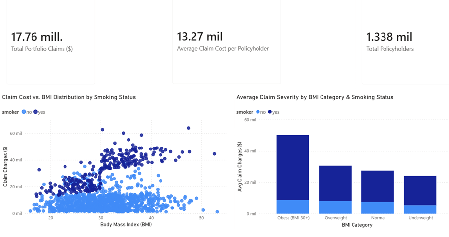
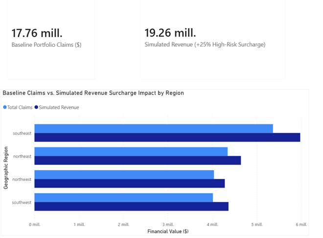

# Health Insurance Claim Risk & Margin Analytics
**SQL, Python, Power BI & Underwriting Risk Strategy**

---

## 1. Executive Summary & Business Context
This project presents an end-to-end analytics and underwriting risk evaluation solution designed to optimize profit margins for health insurance portfolios.

Analyzing a portfolio of **1,338 policyholders** representing an aggregate claims portfolio of **$17.75M USD**, this project identifies severe risk concentration tiers, evaluates loss ratios across risk tiers, and simulates targeted pricing adjustments to recover operating margins without imposing broad, unstrategic premium increases.

---

## 2. Business Problem & Key Objectives
Insurance portfolios often face margin erosion due to unsegmented underwriting where high-risk policyholders heavily subsidize their overall claims cost at the expense of baseline profitability.

* **Primary Objective**: Isolate compound risk drivers (lifestyle habits + clinical metrics) and transform portfolio margins.
* **Core Questions Addressed**:
  1. Which specific policyholder segments drive the highest average claims cost?
  2. Does the portfolio exhibit extreme loss concentration in specific lifestyle/clinical brackets?
  3. How much incremental margin can be unlocked through a targeted underwriting surcharge on the highest risk tier?

---

## 3. Data Pipeline & Modular SQL Analytics
The raw dataset of 1,338 records was ingested into SQLite (`insurance_analytics.db`) using automated Python scripts. The core analytical engine consists of modular SQL queries (`02_risk_and_margin_analysis.sql`):

### Key Analytical Findings:
* **Multi-Factor Risk Profiling**:
  * Policyholders who **smoke and are classified as Obese (BMI $\ge$ 30)** represent the highest risk tier, driving average annual claim charges exceeding **$41,557.99 USD** (compared to an overall portfolio average of $13,270.42 USD).
  * Though this critical segment accounts for only 145 policyholders, it concentrates nearly **33.94% ($6.02M USD)** of the total portfolio claim expenses.
* **Underwriting Margin Transformation**:
  * Applying a simulated **25% premium surcharge** exclusively to high-risk policyholders generates direct, incremental underwriting revenue, expanding operating margins while protecting low-risk policyholder retention.

---

## 4. Repository & File Structure

```text
insurance-claim-risk-margin-analytics/
├── images/
│   ├── executive_overview.png
│   └── margin_optimization.png
├── 01_schema_and_import.sql
├── 02_risk_and_margin_analysis.sql
├── insurance_analytics.db
├── insurance.csv
└── README.md
```


---

## 📊 Power BI Executive Dashboards

### 1. Executive Overview & Risk Profiling
This page highlights high-risk portfolio segments, cost distribution patterns, and severe claim drivers associated with smoking and elevated BMI thresholds.




### 2. Underwriting Margin Optimization & Surcharge Simulation
This page simulates the financial impact of applying a targeted 25% premium surcharge on the high-risk cohort (Smoker + BMI $\ge$ 30), illustrating regional revenue expansion without broad policyholder friction.

